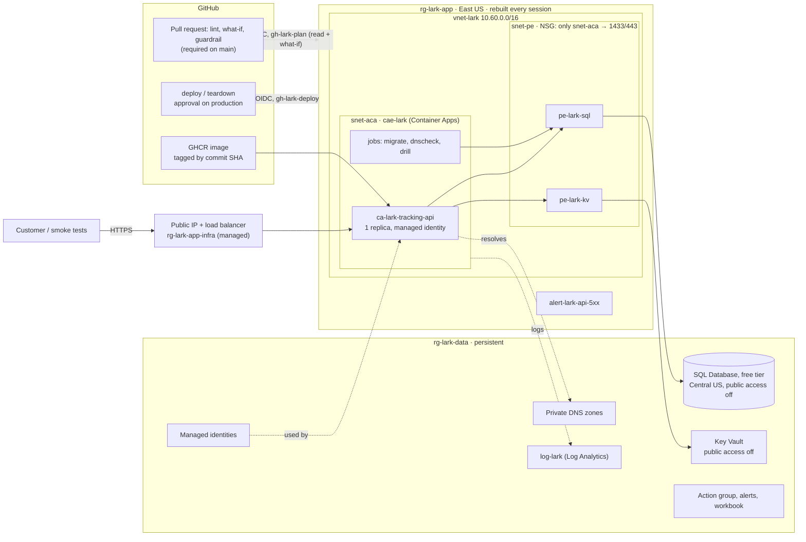

# Larkspur Logistics Azure Platform

> **Status:** complete. M0–M9 delivered and verified with evidence (11-12-2026 to 11-22-2026).
> Start here: [runbook](docs/runbook.md) · [cost report](docs/cost-report.md) · [interview guide](docs/interview-guide.md) ·
> [incident reports](docs/incidents/) · [plan and acceptance criteria](docs/plan.md).

## Scenario

Larkspur Logistics is a **fictional** regional freight carrier with an HQ and several depots. In this project I
design, build and operate the Azure platform behind its customer shipment-tracking API: private data access,
passwordless identity, pipeline-only deployments, monitoring, tested recovery and policy guardrails.

This is my personal portfolio project, built end to end on my own Azure subscription. It's a small,
single-subscription landing zone that I run with production practices. It is not Microsoft's enterprise-scale
landing zone architecture, and it is not a production system serving real customers.

## Architecture (current state)



Detailed view with addresses:

```
  Internet ──HTTPS──▶ public IP (rg-lark-app-infra, managed by Container Apps)
                           │
                          vnet-lark 10.60.0.0/16  (East US, rg-lark-app: rebuilt every session)
                          ├─ snet-aca 10.60.0.0/27   cae-lark (Container Apps, Consumption, external)
                          │                          ├─ ca-lark-tracking-api  API, identity id-lark-tracking-api, 1 replica always on
                          │                          ├─ job-lark-migrate      schema/seed/app user/secret, identity id-lark-migrator
                          │                          ├─ job-lark-dnscheck     resolves the data tier from inside the VNet
                          │                          └─ job-lark-drill        M7 recovery drills, identity id-lark-migrator
                          └─ snet-pe  10.60.1.0/27   NSG: only snet-aca → 1433 / 443
                               ├─ pe-lark-sql 10.60.1.5 ──▶ sql-lark-… (Central US) ─ sqldb-lark-tracking (free tier, locked)
                               └─ pe-lark-kv  10.60.1.4 ──▶ kv-lark-… (East US, purge protection)

  rg-lark-data (persistent): SQL server + database, Key Vault, private DNS zones, log-lark (Log Analytics),
                             managed identities id-lark-tracking-api and id-lark-migrator,
                             ag-lark-ops (email), SQL free-amount and Resource Health alerts,
                             Larkspur Operations workbook
  rg-lark-app alerting:      alert-lark-api-5xx, a log search alert on ContainerAppHTTPLogs (rebuilt every session)
  Image: ghcr.io/chefboyrjeff/larkspur-tracking-api (public GHCR package, built by GitHub Actions)
  Pipeline: GitHub Actions with OIDC (no secrets). Pull requests: validate as gh-lark-plan (read + what-if only).
            deploy / teardown: manual, behind my approval on the "production" environment, as gh-lark-deploy.
            main: a ruleset requires a pull request and all three validate checks (INC-009).
    privatelink.database.windows.net   A sql-lark-… → 10.60.1.5   (written by the endpoint's DNS zone group)
    privatelink.vaultcore.azure.net    A kv-lark-…  → 10.60.1.4

  From the internet: SQL refuses connections (error 47073), Key Vault returns ForbiddenByConnection.
```

## Scope

- Governance: Azure Policy, tags, resource locks, budgets, Entra groups with least-privilege RBAC
- Network: VNet, NSGs, private endpoints, private DNS
- Data and secrets: Azure SQL Database (free tier, Entra-only auth), Key Vault (RBAC)
- App: Azure Container Apps with a managed identity
- CI/CD: GitHub Actions with OIDC, what-if on pull requests, approval-gated deploys
- Operations: Log Analytics, alerts, a workbook, tested restores and incident reports

## Repository structure

```
app/
  larkspur/                    FastAPI shipment-tracking API, migration (python -m larkspur.migrate) and recovery
                               drills (python -m larkspur.drill)
  tests/                       unit tests (run in CI without Azure)
  Dockerfile                   Python 3.12 slim + ODBC Driver 18, non-root
.github/workflows/
  app-image.yml                test, build and publish the image to GHCR
  validate.yml                 every pull request: lint, type checks, /readyz guard, what-if, guardrail (plan
                               identity can't deploy); all three jobs are required checks on main
  deploy.yml                   start a session: verify image, deploy, migrate, smoke tests, idempotency (approval)
  teardown.yml                 end a session: remove the app stack and prove nothing is left billing (approval)
identity/                      custom role definitions for the pipeline identities (JSON)
infra/
  budget.bicep                 $5/month budget on both resource groups (subscription scope)
  governance/                  resource groups, policy assignments, group RBAC (subscription scope)
  shared/naming.bicep          globally unique names, shared by both stacks
  data/                        rg-lark-data: private DNS zones, SQL + database, Key Vault, Log Analytics, identities,
                               action group, persistent alerts, workbook (persistent)
    workbooks/                 Larkspur Operations workbook template (resource IDs are placeholders)
  app/                         rg-lark-app: VNet, NSGs, DNS links, private endpoints, Container Apps, the API's 5xx
                               alert (rebuilt each session)
scripts/
  Remove-LarkAppResources.ps1  end-of-session teardown (run by teardown.yml, or by me locally)
  Initialize-LarkPipeline.ps1  one-time admin setup: custom roles, OIDC app registrations, role assignments
  whatif-drift.jq              idempotency filter: removes documented what-if noise, fails on anything else
  Start-LarkDrill.ps1          runs one recovery drill command in job-lark-drill and reads its log lines back
  Test-LarkPrivateDns.ps1      runs job-lark-dnscheck and shows what the app resolves from inside the VNet (INC-006)
docs/
  plan.md                      plan, milestones, acceptance criteria, design changes
  runbook.md                   start/end a session, health checks, triage by symptom, commands that bite
  cost-report.md               actual cost vs the plan's estimates
  interview-guide.md           how I walk through and defend the project
  incidents/                   incident reports (root cause, remediation, prevention)
  evidence/                    sanitized command output for every milestone
```

Values that identify my tenant (group object IDs, my alert email) live in gitignored `*.local.bicepparam` files,
generated from the committed `*.example.bicepparam` files.

## Progress

| Milestone | Status | Records |
|---|---|---|
| M0 Prerequisites | ✅ Delivered 11-12-2026 | [`docs/evidence/m0-*`](docs/evidence/) |
| M1 Governance | ✅ Delivered 11-12-2026 | [`docs/evidence/m1-*`](docs/evidence/) |
| M2 Network | ✅ Delivered 11-12-2026 | [`docs/evidence/m2-*`](docs/evidence/) |
| M3 Data and secrets | ✅ Delivered 11-12-2026 | [`docs/evidence/m3-*`](docs/evidence/), [INC-001](docs/incidents/INC-001-sql-region-restricted.md), [INC-002](docs/incidents/INC-002-lock-blocks-private-endpoint-teardown.md) |
| M4a Container Apps environment | ✅ Delivered 11-12-2026 | [`docs/evidence/m4a-*`](docs/evidence/) |
| M4b Shipment-tracking API | ✅ Delivered 11-13-2026 | [`docs/evidence/m4b-*`](docs/evidence/) |
| M5 Deployment pipeline | ✅ Delivered 11-13-2026 | [`docs/evidence/m5-*`](docs/evidence/), [INC-003](docs/incidents/INC-003-pipeline-deploy-linked-scope-and-pending-delete.md), [INC-004](docs/incidents/INC-004-teardown-false-positive-verification.md) |
| M6 Observability | ✅ Delivered 11-15-2026 | [`docs/evidence/m6-*`](docs/evidence/), [INC-005](docs/incidents/INC-005-5xx-metric-alert-did-not-fire.md) |
| M7 Backup and recovery | ✅ Delivered 11-17-2026 | [`docs/evidence/m7-*`](docs/evidence/) |
| M8 Operational incidents | ✅ Delivered 11-22-2026 | [`docs/evidence/m8-*`](docs/evidence/), [INC-006](docs/incidents/INC-006-sql-private-dns-link-deleted.md), [INC-007](docs/incidents/INC-007-api-identity-lost-key-vault-role.md), [INC-008](docs/incidents/INC-008-portal-edit-changed-api-client-id.md), [INC-009](docs/incidents/INC-009-policy-denied-pr-tag-rename.md), [INC-010](docs/incidents/INC-010-keepwarm-job-blocked-sql-auto-pause.md) |
| M9 Deliverables | ✅ Delivered 11-22-2026 | [runbook](docs/runbook.md), [cost report](docs/cost-report.md), [interview guide](docs/interview-guide.md), [`docs/evidence/m9-*`](docs/evidence/) |

### M0: Prerequisites

- **Providers:** I registered the 8 resource providers the platform needs before deploying anything.
- **Existing policy:** my subscription already has a `deny-costly-resources` assignment (built-in *Not allowed
  resource types*, from my hub-spoke project) that blocks gateways, firewalls, Bastion, NAT, Application Gateway,
  ExpressRoute, DDoS and vWAN hubs. Nothing in this design uses those types, so I didn't need an exemption.
- **Prices (eastus, retail):** I pulled real prices from the Azure Retail Prices API. Container Apps bills $0.10/hr
  for *Environment Management Hour*, *Dedicated Plan Management* and *Environment Private Endpoint*; my design avoids
  all three, and M4 has to prove that in Cost Analysis. SQL serverless General Purpose is $0.52/vCore-hour beyond the
  free tier. Log Analytics ingestion is free for the first 5 GB, then $2.30/GB. A private DNS zone is $0.63/month,
  so I keep the zones in the persistent resource group instead of recreating them every session.
- **Budget:** I deployed a $5/month budget on `rg-lark-data` and `rg-lark-app` before either group existed.
- **What-if false positive:** after deploying the budget, what-if reported `Modify` on its `contactEmails`. What-if
  can't evaluate `@secure()` parameter values, so it shows the expression instead of the value. I compared SHA-256
  hashes of the deployed and local email values: all three notifications matched, so it's noise, not drift. I kept
  `@secure()`, because removing it would write a personal email address into deployment history.

### M1: Governance

**What I built** (`infra/governance/`): both resource groups with standard tags; policy assignments at
resource-group scope (require a `costCenter` tag, allowed locations, and deny Azure SQL public network access in
`rg-lark-data`); and Entra security groups `lark-ops` and `lark-dev`, which I created in the portal, with
least-privilege RBAC.

| Group | rg-lark-data | rg-lark-app | Why |
|---|---|---|---|
| lark-ops | Reader, Monitoring Contributor | Reader | Operate alerts and workbooks without touching data or secrets |
| lark-dev | none | Reader | Changes ship through the pipeline, not the portal |
| lark-sql-admins (M3) | SQL Entra admin | none | Database administration is a separate, smaller group |

**Key decisions**

- I scoped the policies to the two Larkspur resource groups, not the subscription. My subscription also hosts my
  other projects, and a subscription-wide tag rule would deny their redeployments.
- I grant access to groups, never to individual users, so access changes are membership changes.
- I didn't lock the `rg-lark-data` group. A group lock also locks child resources and would have blocked the
  per-session teardown of the private DNS zone links (see M3 for where the protection ended up).

**Verification**

| Check | Expected | Result |
|---|---|---|
| NSG without `costCenter` tag (eastus) | Denied | ✅ `RequestDisallowedByPolicy`: "Every Larkspur resource needs a costCenter tag…" |
| NSG with tag in `westus` | Denied | ✅ `RequestDisallowedByPolicy`: "Larkspur resources must be deployed to: eastus." |
| NSG with tag in `eastus` | Allowed | ✅ Created, then deleted |
| Re-run what-if after deploy | NoChange | ✅ `11 no change` (after the fix below) |

I wrote custom non-compliance messages in Bicep, and they appear directly in the deny error, so whoever hits a
guardrail learns the rule from the error itself.

**Problem I found and fixed: what-if drift on every run.** The first post-deploy what-if reported `Modify` on all
five policy assignments: `- properties.definitionVersion: "1.*.*"`. Azure now versions built-in policy definitions
and stores `1.*.*` (latest 1.x) when an assignment doesn't specify one. My code didn't declare it, so every what-if
proposed removing it. I moved to API `2024-04-01` (the first version with `definitionVersion`) and declared
`definitionVersion: '1.*.*'`; the re-run showed `11 no change`. Pinning the major version also means a breaking 2.x
of a built-in policy can't silently change these guardrails.

### M2: Network

**What I built**

- `infra/data/` → `rg-lark-data`: private DNS zones `privatelink.database.windows.net` and
  `privatelink.vaultcore.azure.net` (persistent, shared platform service).
- `infra/app/` → `rg-lark-app`: `vnet-lark` (10.60.0.0/16) with `snet-aca` (10.60.0.0/27, delegated to
  `Microsoft.App/environments`) and `snet-pe` (10.60.1.0/27), an NSG on each, and VNet links into both zones.
- `scripts/Remove-LarkAppResources.ps1`: my end-of-session teardown.

| NSG | Priority | Rule | Purpose |
|---|---|---|---|
| nsg-lark-aca | 100 | AzureLoadBalancer → 30000-32767 | Health probes to the environment nodes |
| | 110 | snet-aca ↔ snet-aca | Container Apps infrastructure traffic |
| | 120 | Internet → 80, 443, 31080, 31443 | Public tracking API and environment edge proxy |
| | 4000 | Deny VirtualNetwork | Overrides the default `AllowVnetInBound` |
| nsg-lark-pe | 100 | snet-aca → 1433 | App to SQL private endpoint |
| | 110 | snet-aca → 443 | App to Key Vault private endpoint |
| | 4000 | Deny VirtualNetwork | Only the app subnet reaches the private endpoints |

**Key decisions**

- **Two stacks split by lifecycle.** The DNS zones are persistent and shared; the VNet and everything in it are
  rebuilt each session. The VNet links are children of the zones, so they deploy into `rg-lark-data` from the app
  stack.
- **I explicitly enabled NSG enforcement for private endpoints** (`privateEndpointNetworkPolicies:
  NetworkSecurityGroupEnabled`). Without it, Azure ignores NSG rules for traffic to private endpoints, and the
  `nsg-lark-pe` rules would be decoration.
- **Explicit `Deny-VNet-Inbound` at 4000** on both NSGs. Azure's default `AllowVnetInBound` would let anything in
  the VNet, and later anything peered or connected over VPN (depots), reach the data path.
- **Private subnets** (`defaultOutboundAccess: false`): no implicit internet egress. In M4 I have to verify the
  Container Apps environment's own outbound path still pulls images and reaches Entra ID.
- **My teardown empties `rg-lark-app` but keeps the group**, because the group carries the M1 policy and RBAC
  assignments. The script deletes in dependency order (DNS links → app → environment → private endpoints → VNet →
  NSGs → identities), leaves unknown resource types alone and reports them, and verifies the group is empty.

**Verification**

| Check | Result |
|---|---|
| Lint, both stacks | ✅ exit 0 |
| Deploy, both stacks | ✅ `Succeeded`; no policy denials |
| `global` resources vs the allowed-locations policy | ✅ DNS zones and links allowed (the built-in exempts `global`) |
| Zones and links | ✅ 1 link per zone, `Completed`, auto-registration off, `costCenter` tag present |
| Subnets | ✅ delegation, NSGs, `NetworkSecurityGroupEnabled` on `snet-pe`, default outbound off |
| Rebuild from code + what-if | ✅ `5 no change` (after the fix below) |
| Teardown | ✅ links → VNet → NSGs deleted, `rg-lark-app` empty, zones kept, guardrails still assigned |

**Problems I found and fixed**

1. **What-if drift on `vnet-lark`.** The post-deploy what-if reported `- properties.privateEndpointVNetPolicies:
   "Disabled"`. Azure stores this VNet-level property (API 2024-03-01 and later) with a default, and my template
   didn't declare it. I declared `privateEndpointVNetPolicies: 'Disabled'`.
2. **My first fix didn't reach the deployment.** The re-run still showed the drift. When I checked the file that was
   actually used, it was the old version (no `privateEndpointVNetPolicies` line, 6,291 bytes instead of 6,655), so
   the deployment had run against stale code. With the corrected file in place (verified by content and size), a
   full rebuild from code returned `5 no change`. My takeaway: when a fix "doesn't work", verify the artifact that
   was deployed before changing the fix.

### M3: Data and secrets

**What I built**

- `infra/data/modules/sql.bicep`: SQL logical server `sql-lark-…` in **Central US** with Microsoft Entra-only
  authentication (admin = the `lark-sql-admins` group), public network access disabled, TLS 1.2; and the
  `sqldb-lark-tracking` database on the **free tier** (`useFreeLimit`, `AutoPause` at the monthly limit), protected
  by a `CanNotDelete` lock.
- `infra/data/modules/keyvault.bicep`: Key Vault `kv-lark-…` in East US with Azure RBAC authorization, public
  network access disabled, network ACL `Deny` with no trusted-service bypass, soft delete (7 days) and purge
  protection.
- `infra/app/modules/private-endpoints.bicep`: `pe-lark-sql` and `pe-lark-kv` in `snet-pe`, each with a DNS zone
  group that writes its private A record into the shared zone and removes it when the endpoint is deleted.
- `infra/shared/naming.bicep`: deterministic, globally unique names that both stacks import, so the stack that
  creates the SQL server and the stack that points an endpoint at it can never disagree.

**Key decisions**

- **No passwords anywhere.** Entra-only authentication means no SQL logins exist; in M4 the app will connect with
  its managed identity.
- **Private-only data tier.** Public network access is off on both services, and the M1 policy denies anyone who
  tries to turn SQL public access back on.
- **Protection where the data is** ([INC-002](docs/incidents/INC-002-lock-blocks-private-endpoint-teardown.md)). I
  first locked the SQL server and Key Vault, but a lock also covers the private endpoint connection records Azure
  deletes with each endpoint, so it blocked my teardown. I moved the lock to the database and rely on soft delete +
  purge protection for Key Vault.
- **SQL in Central US, everything else in East US** ([INC-001](docs/incidents/INC-001-sql-region-restricted.md)). My
  subscription is restricted from creating new SQL servers in East US and four other US regions. The private
  endpoint stays in vnet-lark and connects across regions, and only `rg-lark-data` allows `centralus`.

**Verification**

| Check | Result |
|---|---|
| SQL server | ✅ `centralus`, public access `Disabled`, Entra-only, admin `lark-sql-admins` (Group), TLS 1.2 |
| Database | ✅ `GP_S_Gen5`, `useFreeLimit: true`, `AutoPause`, online |
| Key Vault | ✅ RBAC, public access `Disabled`, ACL `Deny`/`None`, purge protection, 7-day soft delete |
| Private endpoints | ✅ both `Approved`; SQL endpoint in East US → server in Central US |
| Private DNS | ✅ `sql-lark-…` → 10.60.1.5, `kv-lark-…` → 10.60.1.4 (match the endpoint NICs) |
| SQL login from the internet with a SQL login | ✅ refused: "Azure Active Directory only authentication is enabled" |
| SQL from the internet with a **valid Entra admin token** | ✅ refused: "Deny Public Network Access is set to Yes", error **47073** |
| Key Vault data plane from the internet | ✅ `ForbiddenByConnection` |
| Re-enable SQL public access | ✅ `RequestDisallowedByPolicy` with my custom message; still `Disabled` |
| Delete the database | ✅ `ScopeLocked`; database still present |
| Rebuild from code + what-if | ✅ data `6 no change`; app shows only the known DNS zone group noise (below) |
| Teardown with the database lock in place | ✅ both endpoints, VNet and NSGs deleted; 0 A records left; data tier intact |

**Problems I found and fixed**

1. **SQL region restriction and a reserved name**: see [INC-001](docs/incidents/INC-001-sql-region-restricted.md).
2. **Lock blocked endpoint teardown**: see [INC-002](docs/incidents/INC-002-lock-blocks-private-endpoint-teardown.md).
3. **A test that didn't test what I meant.** My first "public access is blocked" check used a SQL login, and the
   gateway rejected the login type before it ever evaluated the network rule. That proved Entra-only auth, not the
   network block. I reran the check with a valid Entra token from a `lark-sql-admins` member, which reaches the
   network rule, and got error 47073. A test only proves what it actually exercises.
4. **What-if drift.** The database's `createMode` is write-only (Azure never returns it), so I removed it from the
   template, since `Default` is what Azure uses anyway. The private endpoints' `isIPv6EnabledPrivateEndpoint` is
   returned by Azure but missing from Bicep's type definitions, so I declare it and suppress the type warning with a
   comment explaining why.

**Known what-if noise (accepted):** each private endpoint's DNS zone group shows
`- etag / id / properties.provisioningState / type` under `privateDnsZoneConfigs`. These are read-only properties
Azure adds to every zone config, and a template can't declare them. They don't indicate drift.

### M4a: Container Apps environment

**What I built** (`infra/app/modules/container-apps.bicep`, `infra/data/modules/log-analytics.bicep`)

- `cae-lark`: a workload-profiles Container Apps environment (Consumption profile only) injected into `snet-aca`,
  external, sending logs to `log-lark`.
- `ca-lark-hello`: Microsoft's public quickstart image with external ingress, scaling 0–1. It's a stand-in that
  proves ingress and egress before my own code runs on the platform.
- `job-lark-dnscheck`: a one-shot job that resolves the SQL and Key Vault names from inside the VNet and prints the
  answers.
- `log-lark`: a Log Analytics workspace in `rg-lark-data` with a 0.1 GB/day cap and 30-day retention, so session
  logs survive teardown.

**Key decisions**

- **Consumption only, no environment private endpoint.** Apps scale to zero and stay inside the monthly free grant,
  and there's no dedicated-plan "management hour" charge (M0 pricing). (Since INC-010 the API keeps one replica
  running during a session; the jobs still scale to zero.)
- **I named the managed resource group.** A VNet-integrated environment creates its own group with a Standard Load
  Balancer and public IPs, billed separately from Container Apps. Under the default `ME_…` name my budget (which
  filters by resource group) wouldn't have seen that cost, so I set `infrastructureResourceGroup` to
  `rg-lark-app-infra` and added it to the budget.
- **Egress from a private subnet.** In M2 I made the subnets private (`defaultOutboundAccess: false`) and flagged a
  risk that the environment couldn't pull images. The environment's own load balancer provides the outbound path,
  and the image pull succeeded.
- **A job to prove DNS.** My PC resolves the SQL name to a public IP, so only something inside `vnet-lark` can show
  the private zone's answer. A job is the right shape for that: it runs once and exits. The database migration in M4b
  uses the same pattern.
- **Log Analytics moved forward from M6**, because the environment needs a log destination and the DNS check reads
  its output from the logs.

**Verification**

| Check | Result |
|---|---|
| Environment | ✅ `Succeeded`, external, Consumption, logs to `log-lark`, managed group `rg-lark-app-infra` |
| Managed group | ✅ load balancer + public IP, both carrying my `costCenter` tag (copied from the environment) |
| Budget | ✅ covers `rg-lark-data`, `rg-lark-app`, `rg-lark-app-infra` |
| Ingress and egress | ✅ HTTP 200 from my PC; the image was pulled through the private subnet |
| DNS from inside the VNet | ✅ `sql-lark-….database.windows.net -> 10.60.1.5`, `kv-lark-….vault.azure.net -> 10.60.1.4` (match the endpoint NICs) |
| Teardown | ✅ apps, job, environment, endpoints, VNet and NSGs deleted; `rg-lark-app-infra` removed by Azure; data tier intact |

Log Analytics stores times in UTC; the DNS check ran at 02:45 UTC, which is 11-12-2026 09:45 PM EST.

**Operational note:** deleting the environment is slow. My teardown took 29 minutes (09:57 PM–10:26 PM EST), most of it
waiting for the environment and its managed group to go away. The environment's load balancer and IPs bill until
then, so I start teardown as soon as I'm done with a session.

**What-if after deploy**

| Item | Classification |
|---|---|
| Environment `appLogsConfiguration.customerId` shown as `[reference(...)]` | What-if limitation: it can't evaluate a reference into another resource group (same class as the `@secure()` noise in M0). Accepted. |
| Environment `peerAuthentication` / `peerTrafficConfiguration` (`false`) | Defaults the template doesn't declare yet. I'm declaring them in M4b. |
| `ca-lark-hello` `traffic`, `maxInactiveRevisions`, `exposedPort`, `runningStatus` | Defaults plus a read-only status on the stand-in app. The M4b app module declares the settable ones. |
| DNS zone groups | Known read-only noise (see M3) |

### M4b: Shipment-tracking API

**What I built**

- `app/`: a small FastAPI service. `GET /healthz` checks the process is alive, `GET /readyz` checks private DNS, SQL
  and Key Vault through the managed identity, and `GET /shipments/{trackingNumber}` returns a shipment. Tracking
  numbers are validated (`LRK` + 6 digits) before any database call.
- `app/larkspur/migrate.py`: an idempotent migration that runs as a Container Apps job. It creates `dbo.Shipments`,
  seeds 5 synthetic shipments, creates the app's database user with `SELECT` on that one table, and generates the
  carrier API key in Key Vault without ever printing it.
- `.github/workflows/app-image.yml`: runs the unit tests, builds the image and publishes it to GitHub Container
  Registry. It needs no Azure credentials.
- `infra/data/modules/identities.bicep`: persistent user-assigned identities `id-lark-tracking-api` (Key Vault
  Secrets User) and `id-lark-migrator` (Key Vault Secrets Officer, and a member of `lark-sql-admins`).
- `infra/app/modules/container-apps.bicep`: `ca-lark-tracking-api` and `job-lark-migrate`, both running my image.

**Key decisions**

- **No passwords anywhere.** The app gets an Entra token from its managed identity and passes it to the ODBC
  driver. There's no connection-string secret to store, rotate or leak.
- **Two identities, two blast radiuses.** The API can only read shipments and read secrets. Database administration
  belongs to the migrator, which is an admin only through the `lark-sql-admins` group. If the API were compromised,
  it couldn't change or drop data.
- **The app's database user is created by SID** (`CREATE USER … WITH SID = <client ID>, TYPE = E`). The usual
  `FROM EXTERNAL PROVIDER` form makes SQL look the identity up in Microsoft Graph, which would mean granting the SQL
  server directory-read permissions. Creating the user from the client ID avoids that.
- **Persistent identities in `rg-lark-data`.** The app stack is rebuilt every session; an identity rebuilt with it
  would get a new client ID each time, leaving stale database users and role assignments. The migration also
  detects a client-ID mismatch and recreates the user if an identity is ever replaced.
- **Migrations run as a job inside the VNet.** The database accepts no public connections, so schema changes run
  from inside `vnet-lark`, the same pattern I proved with the DNS check in M4a.
- **Probes hit `/healthz`, never `/readyz`.** A probe that touched the database every few seconds would stop the
  free-tier database from auto-pausing and would fail every time it resumed.
- **Public GHCR image instead of Azure Container Registry.** The image holds no secrets, and a public GHCR package
  costs nothing, versus about $0.17/day for Container Registry Basic.

**Verification** (11-13-2026)

| Check | Result |
|---|---|
| Unit tests in GitHub Actions | ✅ 5 passed; image published as `:main` and `:<commit SHA>` |
| Anonymous pull from GHCR | ✅ HTTP 200 (package is public) |
| Identities and roles | ✅ both identities in `rg-lark-data`; each holds only its own Key Vault role |
| `lark-sql-admins` | ✅ me + `id-lark-migrator` |
| Migration job (08:51 AM EST) | ✅ schema ok, 5 shipments seeded, `id-lark-tracking-api: SELECT on Shipments`, secret created, completed |
| `GET /healthz` | ✅ 200 |
| `GET /readyz` | ✅ 200: SQL resolves to 10.60.1.5 (private endpoint), 5 shipments, secret present (value never returned) |
| `GET /shipments/LRK100001` | ✅ 200 with the shipment, read by the managed identity over the private path |
| `GET /shipments/LRK999999` | ✅ 404 |
| `GET /shipments/not-a-number` | ✅ 400, rejected before any database call |
| What-if after deploy | ✅ no real drift (below); the M4a environment drift is gone |

**What-if after deploy**

| Item | Classification |
|---|---|
| `AZURE_CLIENT_ID` / `APP_IDENTITY_CLIENT_ID` on the app and job, environment `customerId` | What-if can't resolve references into another resource group and shows the expression. The deployed values are correct: both identities authenticated. Accepted. |
| App `exposedPort: 0`, `runningStatus` | `exposedPort` applies only to TCP ingress; `runningStatus` is read-only. Accepted. |
| DNS zone groups | Known read-only noise (M3) |

**Still to confirm:** Cost Analysis data lags about a day, so I'll check the next day that `rg-lark-app-infra` and
Container Apps show no management-hour charge.

### M5: Deployment pipeline

**What I built**

- `.github/workflows/validate.yml`: runs on every pull request that touches infrastructure. It lints every Bicep
  entry point against the rules I set to `error` in `bicepconfig.json`, type-checks every parameter file, runs
  what-if against `rg-lark-app` and posts it to the run summary, and runs a **guardrail**: a real deployment attempt
  as the plan identity that must be refused.
- `.github/workflows/deploy.yml`: starts a session. It resolves the image tag, checks the image exists in GHCR,
  deploys, runs the migration job, smoke-tests the API from the internet, then runs what-if again and fails on any
  real drift.
- `.github/workflows/teardown.yml`: ends a session with my teardown script, then re-checks independently that
  `rg-lark-app` is empty and `rg-lark-app-infra` is gone.
- `scripts/Initialize-LarkPipeline.ps1`: the one-time admin setup. It creates three custom roles, two app
  registrations with GitHub OIDC federated credentials, and the role assignments. It's idempotent, syncs the roles
  from their JSON files, and writes a log with names, roles and scopes only.
- `scripts/whatif-drift.jq`: the idempotency filter. Each rule removes one documented kind of what-if noise;
  anything left is drift and fails the deploy.

**Identities** (no client secrets or certificates on either; both show `secrets=0 certificates=0`)

| Identity | Trusted only for | Roles |
|---|---|---|
| `gh-lark-plan` | `pull_request` | Larkspur What-If Reader on `rg-lark-app` and `rg-lark-data`: `*/read`, what-if and validate. No `deployments/write`. |
| `gh-lark-deploy` | `environment:production` (my approval required, `main` only) | Contributor on `rg-lark-app`; Larkspur Data-Tier Integrator on `rg-lark-data`; Larkspur Group Reader on the subscription |

Larkspur Data-Tier Integrator covers exactly what the app stack touches in the data tier: the VNet links, private
DNS records, auto-approval of the SQL and Key Vault private endpoint connections, attaching the two managed
identities, and pointing a diagnostic setting at `log-lark`. It can't change or delete the database, the vault, its
secrets, the identities or the zones. Larkspur Group Reader has one action, `resourceGroups/read`, so teardown can
prove the Container Apps managed group is gone (INC-004).

**Key decisions**

- **OIDC instead of a client secret.** GitHub issues a short-lived token for each job and Microsoft Entra ID trusts it
  by its subject. There's no secret to store, rotate or leak. The four values I keep as GitHub secrets (tenant,
  subscription and two client IDs) are identifiers, not passwords; I store them as secrets to keep them out of logs.
- **Trust is scoped by subject.** My repository was created after GitHub switched to immutable OIDC subjects, so the
  subject includes the owner and repository IDs (`repo:ChefBoyRJeff@<ownerId>/larkspur-azure-platform@<repoId>:...`).
  A renamed or recreated repository with the same name can't reuse the trust. `gh-lark-plan` trusts pull requests
  only; `gh-lark-deploy` trusts the `production` environment only, which needs my approval and allows only `main`.
- **Two identities, and I prove the read-only one is read-only.** A role that's "supposed to" be read-only isn't a
  control until it's tested. The guardrail job tries a real deployment as `gh-lark-plan` on every pull request and
  fails the PR if it isn't refused with `deployments/write`.
- **Deploys are started manually, not on every push.** The app stack is torn down after every session for cost, so a
  push to `main` has nothing running to update. A session starts with `deploy` and ends with `teardown`, both behind
  my approval.
- **The pipeline deploys only the app stack.** Governance and the data tier hold policies, locks, role assignments and
  data. They stay deployed by me, and the deploy identity gets only what the app stack needs in `rg-lark-data`.
- **The image is pinned to a commit SHA and checked before Azure is touched.** By default the workflow deploys the
  last commit that changed `app/`, because infrastructure-only commits don't produce a new image. It confirms that
  tag exists in GHCR first, so a typo can't half-deploy the stack.
- **Logs through an Azure Monitor diagnostic setting.** The M4a setup put the workspace key in the template through
  `listKeys()`, so the key went through the deployment and even what-if had to read it. With a diagnostic setting the
  key never appears in the template or the deployment history. The deploy identity still needs
  `workspaces/sharedKeys/action` on `log-lark`, because Azure checks the destination too (INC-003).
- **Idempotency is a gate, not a report.** After every deploy, what-if must show no real change. The filter's rules are
  documented below; when the check found real drift on the new diagnostic setting, I fixed the template instead of
  adding a rule.
- **One targeted retry.** `deploy` retries once, only for Azure's "pending delete operation" conflict (INC-003). Every
  other failure stops the run with the full error message.

**What-if noise the idempotency filter removes** (each one investigated earlier)

| Rule | Why it's noise |
|---|---|
| DNS zone groups: `etag`, `id`, `provisioningState`, `type` inside `privateDnsZoneConfigs` | Read-only properties Azure returns (M3) |
| `properties.runningStatus` on the app | Read-only status (M4b) |
| `properties.configuration.ingress.exposedPort` | TCP-only setting Azure stores as 0 for HTTP apps (M4b) |
| Values shown as `[reference(...)]` | What-if can't resolve references into another resource group; the smoke tests prove the deployed values (M4a/M4b) |

**Verification** (11-13-2026)

| Check | Result |
|---|---|
| Pipeline identities | ✅ 3 custom roles, 2 app registrations with 1 federated credential each, 0 secrets and 0 certificates, every assignment scoped as designed ([`m5-01`](docs/evidence/m5-01-pipeline-identity.txt), [`m5-08`](docs/evidence/m5-08-group-reader.txt)) |
| PR #1 `validate` | ✅ lint and build; what-if as `gh-lark-plan`: 14 to create, 9 to ignore; guardrail refused with `deployments/write` ([`m5-02`](docs/evidence/m5-02-validate-pr1.txt)) |
| Deploy run 1 | ❌ linked-scope permission and a pending delete (INC-003) ([`m5-03`](docs/evidence/m5-03-deploy-run1-failed.txt)) |
| Deploy run 2 | ✅ deploy, migration and smoke tests; ❌ idempotency: 4 real changes on the new diagnostic setting ([`m5-05`](docs/evidence/m5-05-deploy-run2-drift.txt)) |
| Deploy run 3 | ✅ every step, **Idempotency: PASS** ([`m5-06`](docs/evidence/m5-06-deploy-run3-pass.txt)) |
| Smoke tests (run 3) | ✅ `/healthz` 200; `/readyz` 200 with SQL at 10.60.1.4 (private endpoint), 5 shipments, secret present; LRK100001 200; LRK999999 404; bad input 400 |
| Teardown run 1 | ✅ everything deleted; ❌ the managed-group check was refused but reported "gone" (INC-004) ([`m5-07`](docs/evidence/m5-07-teardown-run1-forbidden.txt)) |
| Teardown run 2 | ✅ `rg-lark-app` empty, `rg-lark-app-infra` gone, proven by a real answer ([`m5-09`](docs/evidence/m5-09-teardown-run2-verified.txt)) |
| Log routing | ✅ rows in the resource-specific `ContainerAppConsoleLogs` table, after Azure's documented activation time of up to 90 minutes for a new diagnostic setting ([`m5-10`](docs/evidence/m5-10-log-routing.txt)) |

**What I'd do differently in production:** branch protection on `main` (done in M8: since INC-009 a ruleset requires a
pull request and all three `validate` checks), a second approver instead of approving my own deploys, and a separate non-production
environment that deploys automatically on merge.

### M6: Observability

**What I built**

| Alert or view | Signal | Where it lives | Why there |
|---|---|---|---|
| `ag-lark-ops` (action group) | Email to me, common alert schema | `rg-lark-data` | Every alert routes here; the address is a `@secure()` parameter from my gitignored local file |
| `alert-lark-sql-free-amount` | Metric `free_amount_remaining`, Minimum below 10,000 vCore-seconds (Microsoft's recommended 10%), checked hourly | `rg-lark-data` | The free tier pauses the database for the rest of the month when its 100,000 vCore-seconds run out |
| `alert-lark-data-resource-health` | Activity log: Resource Health, platform-initiated, Degraded or Unavailable | `rg-lark-data` | Azure-side outages of SQL or Key Vault; filtering on PlatformInitiated keeps my own actions and auto-pause from paging me |
| `alert-lark-api-5xx` | Log search: `ContainerAppHTTPLogs`, `StatusCode >= 500`, 5 or more in 15 minutes, every 5 minutes | `rg-lark-app` (deployed with the app) | It watches a resource that's rebuilt every session |
| Larkspur Operations workbook | Requests by status class, a 5xx table, app warnings and errors, SQL free amount remaining | `rg-lark-data` | It reads `log-lark`, which keeps 30 days of logs after each teardown |
| Budget (since M0) | Email at 50% and 100% of actual and 100% of forecast on $5/month | Subscription | Already covered the cost-alert requirement |

**Key decisions**

- **Persistent alerts in the data tier, session alerts in the app stack.** An alert on the API has to be created after
  the API exists and deleted before teardown can prove the group empty, so the pipeline owns it. The action group is
  persistent, so both kinds notify the same place.
- **The 5xx alert is a log search alert, not a metric alert (INC-005).** My first version used the `Requests`
  metric. In the controlled failure the API returned 10 x HTTP 500 and the metric recorded 2 of at least 15 requests
  that session, so it never fired. `ContainerAppHTTPLogs`, the ingress's own per-request log, recorded every one.
- **15-minute window, checked every 5 minutes.** A request's log row is stamped with its start time but only arrives
  after it finishes; the failing requests took up to 200 seconds.
- **The workbook is created from code.** I built it in the portal against real session data, but saving it was
  refused by my M1 policy (`costCenter` tag required, and the workbook Save dialog has no tags field). I exported the
  Gallery Template JSON, replaced the resource IDs with placeholders, and deploy it from Bicep with the standard tags.
- **Every data-tier deploy goes through a what-if gate.** It deploys only if the expected resources are the only real
  changes. Two documented noise patterns there: role assignments whose `principalId` shows as an unresolved
  `[reference()]` (I proved the principals match before and after), and the action group's `emailAddress`, which
  what-if can't see because it's a secure value (I compare SHA-256 hashes of the file value and the stored value).
- **Cost: about $0.** One metric alert time series (the first 10 per month are free); activity log alerts are free;
  the log search alert is about $1.50/month if it ran all month, but it only exists during sessions; the first 1,000
  emails per month are free; workbooks are free.

**Controlled failure** (the test that matters: an alert isn't done until it has fired on a real failure)

I changed `Allow-SQL-From-App` on `nsg-lark-pe` from Allow to Deny in the portal, so the API couldn't reach SQL, and
sent 10 parallel requests. The rule still says "Allow" in its name while it denies, which is what a misconfiguration
looks like to whoever is on call.

| Run | Result |
|---|---|
| 1, metric alert | ❌ 10 x HTTP 500 at 12:59 PM; the alert never fired. Root cause and fix: INC-005 ([`m6-03`](docs/evidence/m6-03-controlled-failure.txt)) |
| 2, log search alert | ✅ 10 x HTTP 500 at 01:55 PM; **fired at 02:04 PM**; fixed in the portal at 02:12 PM; **resolved at 02:20 PM**; both emails received ([`m6-04`](docs/evidence/m6-04-controlled-failure-log-alert.txt)) |

Detection took 9 minutes after the failing requests finished: the 5-minute check interval, plus log ingestion, plus
the time the failing requests themselves took.

**Verification** (11-15-2026)

| Check | Result |
|---|---|
| Persistent alerting | ✅ 3 resources created; what-if gate passed; Key Vault role assignments proven unchanged ([`m6-01`](docs/evidence/m6-01-persistent-alerts.txt)) |
| Email path | ✅ "Test action group" email received |
| SQL free amount metric | ✅ 5 data points in 72 hours, 99,340 → 97,011 vCore-seconds; Azure publishes it only occasionally, so the alert evaluates whenever a data point exists |
| Deploy with the metric alert | ✅ every step, Idempotency: PASS ([`m6-02`](docs/evidence/m6-02-deploy-session.txt)) |
| Deploy with the log search alert | ✅ every step, Idempotency: PASS, so the new resource type adds no drift ([`m6-05`](docs/evidence/m6-05-deploy-log-alert.txt)) |
| Log activation this session | ✅ diagnostic setting created at 12:26 PM, first console row at 12:27 PM (the M5 open question: this time about a minute, not the 90-minute worst case) |
| Teardown | ✅ the log search alert deleted first; `rg-lark-app` empty; `rg-lark-app-infra` gone ([`m6-06`](docs/evidence/m6-06-teardown.txt)) |
| Workbook | ✅ created from code with `costCenter`; 6 items, no placeholders left; all 4 data panels load; the portal copy removed ([`m6-07`](docs/evidence/m6-07-workbook.txt)) |

**What I'd do differently in production:** an availability test from outside Azure (it would catch DNS or
certificate problems that never reach the logs), alert processing rules for maintenance windows, a second
notification channel besides email, and an investigation of the `Requests` metric gap with Microsoft support.

### M7: Backup and recovery

**What I built**

- `app/larkspur/drill.py`: recovery drill commands that run inside the VNet, because the database and Key Vault
  accept no public connections. `mark` writes timestamped rows (simulated activity), `corrupt` is the simulated
  incident, `snapshot` and `compare` summarize databases (row count, checksum, statuses, newest marker), `repair`
  copies good values back from a restored copy, and `secret-delete` / `secret-recover` / `secret-check` drill Key
  Vault. Destructive commands need `--confirm`, database names must match `sqldb-lark-tracking…`, `repair` refuses
  the live database as its source, and the secret's value is never printed (only a 12-character SHA-256
  fingerprint). 7 unit tests cover those guards.
- `job-lark-drill` in `infra/app/modules/container-apps.bicep`: a manual Container Apps job with the migrator's
  identity (a `lark-sql-admins` member, so it can open a restored copy; Key Vault Secrets Officer, so it can delete
  and recover the secret). Its default command is the read-only `secret-check`.
- `scripts/Start-LarkDrill.ps1`: runs one drill command and prints its log lines. The Jobs Start API accepts an
  execution template, but an override **replaces the whole template**, so the script reads the job's current
  container (image, command, env, resources), changes only the arguments, starts one execution, waits for it, and
  reads its `LARK-DRILL` lines from `ContainerAppConsoleLogs`. The job's saved configuration never changes.

**Drill A: corrupted data, point-in-time restore** ([`m7-01`](docs/evidence/m7-01-baseline.txt) to
[`m7-05`](docs/evidence/m7-05-drill-a-results.txt))

| Time (EST, 11-17-2026) | Event |
|---|---|
| 09:56 AM | Baseline: 5 shipments, checksum -1817112085 |
| 10:31–10:35 AM | 10 marker rows written 20 s apart (the first one 72 s after the job started: the free database waking from auto-pause) |
| 10:44:47 AM | `start corrupt`, the last known good moment, chosen as the restore point |
| 10:44:49 AM | **Incident:** every shipment's status overwritten; customers saw `"status":"LOST: drill"` |
| 11:04:04 AM | Point-in-time restore requested to a new database, `sqldb-lark-tracking-restore` |
| 11:24:02 AM | Restore complete (19 min 58 s) |
| 11:35:21 AM | `compare`: the copy matched the baseline checksum, with all 10 markers |
| 11:46:11 AM | `repair`: 5 of 5 shipments fixed in 2.3 s; live checksum back to -1817112085 |
| 12:08:44 PM | Copy deleted; the live database's `CanNotDelete` lock still in place |

| Measure | Result |
|---|---|
| RPO (data lost) | **0 rows.** All 10 markers were in the copy; the restore point was 2 s before the bad update |
| RTO (incident to repaired) | **61 min 22 s:** 19 min 15 s before the restore started (waiting for log lines and a log backup to cover the restore point), 19 min 58 s of restore, 22 min 09 s from restore to repair |

- **Restore to a copy, then copy the data back.** Azure SQL can't restore over an existing database, and swapping
  names would have replaced my free-tier database with a paid one and left the delete lock on the wrong database.
  Copying back only the damaged values is Microsoft's documented data-recovery pattern.
- **The restored copy** was General Purpose serverless, 1 vCore maximum, local backup redundancy, zone redundancy
  off ($0.63/vCore-hour retail in Central US, checked 11-17-2026); restores can't target the free offer.
- **Restores don't copy tags**, and my `costCenter` policy would deny an untagged database, so the restore command
  copied the live database's tags and added `purpose=m7-restore-drill`.
- **Only about 20 of the 61 minutes were Azure.** The rest was process: 8-minute log latency on every drill step,
  waiting for a log backup, verification, and an unexpected PC reboot during the restore. Azure finished the restore
  server-side; my re-run then failed with `RemoteDatabaseExists` and overwrote the evidence file, so I rebuilt the
  timeline from the activity log.
- **Correction I made:** `az monitor activity-log list` returns 50 events by default. My first reading of the
  timeline started at the policy audit (11:14:34 AM) and put the restore at about 9.5 minutes; with
  `--max-events 500` the real request was 11:04:04 AM, so the restore took 19 min 58 s.
- **Observed, not explained:** the copy reported `minCapacity` and `autoPauseDelay` as null even though the restore
  passed `--min-capacity 0.5 --auto-pause-delay 60`, and the activity log shows one more successful write on the
  copy at 11:40:13 AM that I can't attribute to anything I ran.

**Drill B: deleted secret, soft-delete recovery** ([`m7-06`](docs/evidence/m7-06-drill-b.txt))

| Time (EST) | Event |
|---|---|
| 12:10:54 PM | `carrier-api-key` deleted (version `2a0560b2…`, fingerprint `cb12431e0d99`); scheduled purge 11-24-2026 |
| 12:21:33 PM | `/readyz` → **503** (`SecretNotFound`); SQL and DNS still healthy |
| 12:23:36 PM | `/shipments/LRK100001` → **200**: customer lookups don't use the secret |
| 12:24:30 PM | Recovered in 5.7 s: **same version, same fingerprint** |
| 12:28:54 PM | `/readyz` → 200 |

The readiness probe hits `/healthz`, not `/readyz` (an M4b decision). If it probed `/readyz`, this incident would
have taken the only replica out of service and broken shipment lookups that never needed the secret.

**Drill C: bad release, rollback** ([`m7-07`](docs/evidence/m7-07-drill-c.txt))

I merged a deliberately bad change (PR #10): the shipment query read `ShipmentStatus`, a column that doesn't exist.
`/healthz` and `/readyz` don't touch that query and the unit tests don't touch SQL, so the PR was green.

| Time (EST) | Event |
|---|---|
| 12:40:37 PM | Deploy finished: the bad revision is serving customers |
| 12:41:32 PM | **Smoke test failed:** `/shipments/LRK100001` → 500; deploy stopped before idempotency (55 s after going live) |
| 12:42:53 PM | Rollback started: deploy with `image_tag` = `cd7cde6…`, the last good image |
| 12:45:20 PM | Good revision serving |
| 12:46:44 PM | Smoke tests pass; idempotency passed at 12:47:04 PM |
| 12:55:26 PM | PR #11 reverts the bad commit on `main` |

The bad release was live for **4 min 43 s**. With `activeRevisionsMode: Single`, a new revision takes all traffic
as soon as it's deployed, so the smoke test caught the problem after customers could already see it. I rolled back by
redeploying the last good image through the pipeline instead of reactivating the old revision, so the code in `main`,
the deployment and the idempotency check stayed the source of truth.

**Found along the way: a latent deploy bug.** `deploy.yml` found its image tag with `git log -1 -- app`. After a
pull request merge, that returns the branch's own commit, but app-image tags the image with the **merge commit's**
SHA, so deploy would have looked for an image that was never pushed. It had never fired because my only earlier
image didn't come through a PR merge. I proved it in a scratch repository and added `--first-parent`; the first
deploy after PR #9 resolved the merge commit `cd7cde6`. That same run also started 30 seconds before app-image finished
pushing, and the image check stopped it before anything touched Azure, which is why that check runs first.

**Verification** (11-17-2026)

| Check | Result |
|---|---|
| PR #9 checks | ✅ validate (what-if: `+ job-lark-drill`; guardrail refused) and app-image (12 tests) |
| Deploy with the drill job | ✅ every step, Idempotency: PASS |
| Drill A | ✅ copy identical to the baseline; live database repaired; RPO 0 rows; RTO 61 min 22 s |
| Drill B | ✅ same secret version and fingerprint after recovery; `/readyz` 503 → 200 |
| Drill C | ✅ smoke tests caught the bad release; rollback passed smoke tests and idempotency; `main` reverted |
| Restored copy | ✅ deleted; only `master` and `sqldb-lark-tracking` left; lock still in place |
| Teardown | ✅ `job-lark-drill` and the rest of the stack deleted; `rg-lark-app` empty; `rg-lark-app-infra` gone ([`m7-08`](docs/evidence/m7-08-teardown.txt)) |

**What I'd do differently in production:** multiple-revision mode with a traffic split, so a new revision is
smoke-tested through its own URL at 0% traffic before it serves anyone; geo-redundant backups (mine are locally
redundant, so geo-restore isn't available); a recovery runbook with pre-built commands to cut the process time out of
the RTO; and unit tests that run the API's SQL against a real database, which would have caught Drill C's bug at the
pull request.

### M8: Operational incidents

I broke the platform five times on purpose and worked each one as on-call: symptoms first, then hypotheses ruled in
or out with evidence, the root cause, a fix through the normal path (pipeline or PR, not a portal patch), verification,
and an incident report with prevention. Each incident is a realistic mistake, the kind a well-meaning person makes.

| Incident | What broke | Layer | How I found it | Impact | Fix | Report |
|---|---|---|---|---|---|---|
| INC-006 | The SQL private DNS zone lost its VNet link (a "cleanup" delete) | Network / DNS | 5xx alert email; `/readyz` showed SQL resolving to a public IP | Lookups failed for 62 min 56 s | Pipeline redeploy recreated the link | [INC-006](docs/incidents/INC-006-sql-private-dns-link-deleted.md) |
| INC-007 | The API identity lost its Key Vault Secrets User role | Authorization (403 naming the caller) | `/readyz` 503 | `/readyz` 503 for 9 min 38 s; lookups unaffected | Data-stack deploy behind its what-if gate | [INC-007](docs/incidents/INC-007-api-identity-lost-key-vault-role.md) |
| INC-008 | A portal edit pointed `AZURE_CLIENT_ID` at the migrator identity | Authentication (no token issued) | 5xx alert email; revision diff | Lookups 500 for at most 23 min 37 s | Pipeline redeploy | [INC-008](docs/incidents/INC-008-portal-edit-changed-api-client-id.md) |
| INC-009 | A PR renamed the `costCenter` tag key | Governance (Azure Policy Deny) | The PR's what-if: `RequestDisallowedByPolicy` | None: never deployed, but the PR was mergeable with a red check | `validate` runs on every PR and is required by a ruleset on `main` | [INC-009](docs/incidents/INC-009-policy-denied-pr-tag-rename.md) |
| INC-010 | A keep-warm job called `/readyz` every 5 minutes | Cost / capacity | Database status and metrics; no alert fired | The free database never paused: about 2.3 days to the monthly limit, then locked until the next month | Deleted the job (mitigation); removed it, API `minReplicas: 1`, a required lint guard against `/readyz` in `infra/` | [INC-010](docs/incidents/INC-010-keepwarm-job-blocked-sql-auto-pause.md) |

**What the five have in common**

- **The error type points at the layer.** A DNS answer outside `10.60.1.x` is the network; a 403 that names the
  caller is authorization; `CredentialUnavailableError` with no token is authentication. INC-007 and INC-008 broke the
  same dependencies and were told apart in minutes by the error alone.
- **Fixes go through the same path as every other change.** Four of the five were fixed by a pipeline deploy or a PR,
  so the fix got the same what-if, approval and smoke tests. The one manual step (deleting the keep-warm job) was a
  mitigation, needed because the pipeline deploys in Incremental mode, which doesn't delete resources removed from
  the template.
- **My guardrails had gaps, and the incidents found them.** An alert that auto-resolves when traffic stops
  (INC-006), what-if noise that hides real drift (INC-008), a check that didn't block the merge (INC-009), and a design
  rule that lived only in a comment (INC-010). INC-006 even proposed a scheduled `/readyz` probe and warned it would
  keep the free database awake; INC-010 measured that warning.
- **Least privilege held for everyone but me.** `lark-dev` and `lark-ops` are Reader; every break needed my Owner
  account. In production, Owner would be a break-glass role.

**Measured along the way**

| Measurement | Result |
|---|---|
| RBAC propagation (INC-007) | Removal effective within 1 min 44 s; the new grant within 26 s |
| 5xx alert latency | About 7–11 minutes after the first failures; it auto-resolves when traffic stops, even if the cause remains |
| Policy in the PR what-if (INC-009) | The read-only plan identity's what-if is denied by preflight; denials reach the activity log about 2 minutes later |
| Free SQL auto-pause (INC-010) | 15–17 minutes after the last use, even though the resource reports `autoPauseDelay: 60` |

**What I'd do differently in production:** an outside-in availability test that doesn't touch the database (or a
paid database tier where staying awake is fine); a scheduled drift check between deploys for values what-if can't
resolve; an alert on the free database's burn rate instead of only its 10,000 floor; and Owner as a break-glass role
with access reviews, not my daily account.

### M9: Deliverables

- **Runbook** ([docs/runbook.md](docs/runbook.md)): starting and ending a session, a health check, changing the data
  stack behind its what-if gate, triage by symptom for every incident and drill, and the commands that caught me out.
- **Architecture diagram:** the Mermaid diagram at the top of this README, next to the detailed address view.
- **Cost report** ([docs/cost-report.md](docs/cost-report.md)): **$1.68** in actual charges for the whole project
  (11-01 to 11-22-2026), every line matched to a design item; the only SQL charge was the M7 restored copy.
- **Interview guide** ([docs/interview-guide.md](docs/interview-guide.md)): a 3–5 minute walkthrough, a 10-minute
  deep dive and answers grounded in this repository.
- **Clean-run proof:** a final deploy from `main` onto an empty `rg-lark-app`, smoke-tested and torn down
  ([`m9-01`](docs/evidence/m9-01-clean-run.txt)).

## Limitations and what I'd build next

| Limitation | Why it's acceptable here | What I'd do |
|---|---|---|
| I approve my own deploys, and Owner is my daily account | One-person project | A second approver; Owner as a break-glass role with access reviews |
| One environment | Cost: the stack only exists during a session | A non-production environment that deploys on merge |
| No drift detection between deploys (INC-008) | The deploy repairs drift and its smoke tests catch the impact | A scheduled check comparing live values (such as `AZURE_CLIENT_ID`) with the expected ones |
| The idempotency filter drops any value starting with `[reference(` (INC-008, INC-010) | Every dropped value is checked functionally by the smoke tests | Compare against resolved expected values instead of matching strings |
| The free-amount alert fires only below 10,000 vCore-seconds (INC-010) | Sessions are short and the database pauses | A burn-rate alert (for example, Online for more than 2 hours) |
| No outside-in availability test | A scheduled `/readyz` call would keep the free database awake (INC-006, INC-010) | A probe of `/healthz` from outside Azure, or a paid database tier |
| Single revision mode, so a new revision serves customers at once (M7 Drill C, INC-008) | The smoke tests run within a minute | Multiple revision mode: smoke-test at 0% traffic, then shift |
| Locally redundant backups, no zone redundancy, no WAF | Free tier and budget | Geo-redundant backups, zone redundancy, Front Door with WAF |
| The data-stack what-if gate is a manual check | Changes there are rare and admin-only | Script it, including the workbook hash comparison |

## Skills demonstrated

| Area | Where | AZ-104 domain |
|---|---|---|
| Entra groups, RBAC, custom roles, managed identities, OIDC federation | M1, M4b, M5, INC-007, INC-008 | Manage Azure identities and governance |
| Azure Policy, tags, locks, budgets | M1, M3, INC-002, INC-009 | Manage Azure identities and governance |
| Backup and recovery: SQL point-in-time restore, Key Vault soft delete, release rollback | M7 | Monitor and maintain Azure resources |
| SQL Database and Key Vault with Entra-only access | M3, M4b | (data services, beyond AZ-104's storage-account focus) |
| Container Apps, jobs, revisions, scaling | M4a, M4b, M7, INC-010 | Deploy and manage Azure compute resources |
| VNets, subnets, NSGs, private endpoints, private DNS | M2, M3, INC-006 | Implement and manage virtual networking |
| Log Analytics, KQL, metric and log search alerts, workbooks, activity log | M6, M8 | Monitor and maintain Azure resources |
| Bicep, what-if, GitHub Actions, required checks | M1–M9 | (beyond AZ-104: infrastructure as code and CI/CD) |
| Incident response: hypotheses, evidence, root cause, prevention | INC-001 to INC-010 | (operations practice) |

## Cost

Actual: **$1.68** from 11-01 to 11-22-2026 ([cost report](docs/cost-report.md)). Running costs by item:

| Item | Running cost |
|---|---|
| SQL database (free tier, AutoPause at the limit) | $0; pauses about 15–17 minutes after its last use (measured in INC-010). 80,050 of 100,000 vCore-seconds left on 11-22-2026 |
| Key Vault (idle) | ~$0 |
| Private DNS zones (2, persistent) | ~$1.26/month |
| Private endpoints (2) | ~$0.01/hr each, only while a session is running |
| Container Apps environment infrastructure (load balancer + 2 public IPs) | ~$0.035–0.04/hr (estimate), only while a session is running |
| Container Apps usage | expected within the monthly free grant: jobs scale to zero, the API keeps 1 replica (0.5 vCPU, 1 GiB) only while a session is running (INC-010); to confirm in Cost Analysis in M9 |
| Container image (public GHCR package) | $0 |
| Managed identities | $0 |
| Log Analytics | within the free ingestion allowance; 0.1 GB/day cap |
| Budget alert | $5/month on both resource groups |
| Alerts and workbook | ~$0: 1 metric time series (10 free), free activity log alert, log search alert only during sessions, free emails and workbook |
| GitHub Actions | $0 (public repository, GitHub-hosted runners) |
| M7 restored database copy (one-off) | GP serverless at $0.63/vCore-hour (retail, Central US, 11-17-2026); existed about 45 minutes, so under $0.50 |

## Teardown

At the end of every session I run the **teardown** workflow (Actions → teardown → Run workflow, then approve). It
runs the same script I can run locally:

```powershell
./scripts/Remove-LarkAppResources.ps1 -WhatIf   # preview
./scripts/Remove-LarkAppResources.ps1           # delete and verify
```

It removes the DNS zone links, then everything inside `rg-lark-app` in dependency order (the API's alert rule, apps
and jobs, environment, private endpoints, VNet, NSGs, identities), verifies the group is empty, and waits up to 10
minutes to confirm Azure has removed `rg-lark-app-infra`. If it can't check, or the group is still there, it fails
instead of reporting success (INC-004). `rg-lark-data` stays: it holds the data and logs and costs about $0 when idle.
